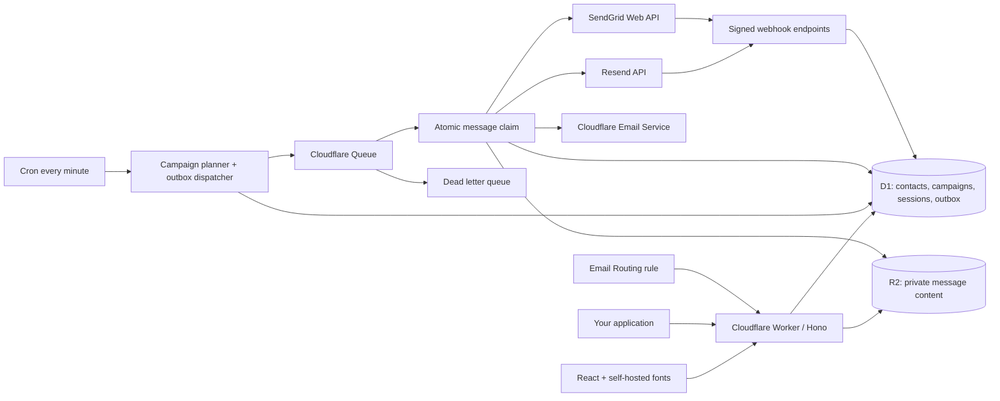

# GeneSend architecture

GeneSend is an MIT-licensed, single-owner email workspace. All application infrastructure runs on Cloudflare. Cloudflare Email Service (native binding or dedicated-token REST) delivers transactional messages; optional Resend and SendGrid adapters deliver transactional and marketing messages.

## Runtime and data flow

Assets, fonts, API, SQL, blobs, asynchronous execution and scheduling are hosted on Cloudflare. The browser makes no direct requests to either ESP. Sending through an external ESP shares the recipient, content and required metadata with that provider. No proprietary AutoSend assets or code are used.

## ADR 001: A modular Worker rather than a fleet of microservices

Alternatives: Node/Postgres/Redis; multiple separately deployed Workers; one modular Worker with D1, R2 and Queues. The last option meets the Cloudflare requirement and keeps self-hosting manageable. Modules separate authentication, orchestration, provider credentials and delivery. Queue and cron handlers use the same deployment. This is appropriate for the first single-owner release, not a claim of unlimited throughput.

## ADR 002: Transactional outbox and atomic claims

The API writes private content to R2, then a D1 outbox record, before returning 202. A queue publication failure leaves a recoverable database job. The dispatcher atomically changes queued → enqueued. Consumers atomically change enqueued → processing, so duplicate Queue deliveries cannot call the provider twice concurrently.

Known pre-delivery rate-limit responses get exponential backoff. Unknown network outcomes become uncertain. A processing lease older than 15 minutes also becomes uncertain rather than being resent. Stale enqueued rows may be republished; terminal or processing rows cannot be claimed again.

There is no distributed transaction with an ESP. Exactly-once external delivery is not promised. A crash between claiming and sending can require manual inspection. Operators should inspect provider receipts before creating a replacement send.

## ADR 003: SQL campaign snapshots

At launch, a campaign locks its delivery provider. When the schedule becomes due, SQL snapshots subscribed, unsuppressed recipients and their personalization data. A stable (campaign, contact) key prevents duplicate enrollment. Generation is claimed once per minute; delivery attempts are also guarded by an atomic per-campaign fixed-minute counter. Current subscription and suppression state are rechecked at the provider boundary.

Pause blocks new generation and postpones queued jobs. Cancel cancels pending and queued work. An already-running provider call can still complete; no UI promises a recall. completed means that all jobs have reached a terminal processing state, not that all recipients received the mail.

## ADR 004: Native plus optional external delivery

Cloudflare explicitly limits its native channel to transactional email. Marketing cannot select that channel. Resend and SendGrid need their own verified sender domains. Changing the default provider does not reroute already-created jobs. Resend requests include the message ID as their provider idempotency key. SendGrid uses custom_args.genesend_id for signed event correlation and has no assumed request idempotency guarantee.

Retries only occur for explicit rate/internal pre-delivery responses. Ambiguous external responses are conservatively uncertain. Provider delivery notifications update accepted/uncertain states and do not make an inbox-placement claim.

## ADR 005: Credentials and authentication

Owner bootstrap access uses a generated random key whose SHA-256 hash is a Worker secret. Login creates a random, hashed server-side session with a seven-day HttpOnly, Secure, SameSite=Strict cookie. Login attempts are limited by a salted IP hash. Browser mutations reject foreign Origin headers.

API keys are random, scoped to send/read/contacts, shown once, hashed at rest and revocable. They are workspace-wide within their scopes; this is not tenant isolation. API calls are limited to 120 per key per minute. A public /api/demo tree serves only hard-coded fictional data; it never queries private tables.

An optional Cloudflare Email REST token is kept in the Worker secret CLOUDFLARE_EMAIL_API_TOKEN, with its account ID in a non-secret environment variable. The reference token grants only Email Sending Write within the selected account; its policy grants no Workers, DNS or D1 permission. The Worker falls back to its native EMAIL binding when no dedicated token is present.

ESP credentials are AES-GCM encrypted in D1 using a key derived from SESSION_SECRET. The Worker secret must be backed up securely. Do not rotate it casually: existing provider ciphertext and signed unsubscribe/tracking URLs rely on it. In this version key rotation requires a coordinated migration, not simply overwriting the secret. An administrator who can execute production Worker code can decrypt credentials; encryption protects storage disclosure, not a compromised runtime.

## ADR 006: Evidence and privacy

Message states: queued, enqueued, processing, accepted, delivered, failed, uncertain, suppressed, cancelled. Accepted is provider acceptance; delivered is a confirmed provider delivery event, not inbox placement.

Tracking is off by default. Optional open pixels and signed click links record unique message signals. Image proxies, bot scanners and privacy software affect these measurements; they are not proof of human reading. Preview iframes are sandboxed and use a CSP blocking external resources and scripts, so previewing content does not load tracking pixels.

Marketing includes organization/address footer, signed unsubscribe URL, and RFC 8058 one-click headers. GET renders a confirmation page; POST applies the opt-out. Imports never silently resubscribe an existing opt-out. Complaint/hard-bounce suppressions block both kinds of mail.

## Event automations

A custom event with a unique event_id matches active workflows. Each workflow has one transactional template and an optional delay of up to 30 days. The event receipt persists the original timestamp and payload hash, preventing a duplicate event from shifting delivery time. A different payload with the same event ID returns 409. Already queued messages remain queued when a workflow is paused; pause stops new enrollment.

This is not a visual branching or multi-step sequence engine. Business events should reflect genuine transactional intent; selecting a transactional channel does not change the meaning of promotional content.

## Inbound

The Email Routing handler accepts only configured recipient domains and messages up to 5 MB. Parsed text/HTML and attachment metadata are stored in private R2/D1. It does not configure or replace existing MX records or routing rules. Add a dedicated address routing rule yourself. Attachment download and threading are future work.

## Operations and limits

- Scheduled dispatch runs each minute; campaign generation is bounded to 100 recipients per minute per campaign, and up to ten active campaigns per scan.
- Queue messages carry only a database ID. The consumer batch size is five; each message is acknowledged or retried independently.
- Login/session/rate-window housekeeping runs with dispatch.
- The activity view returns the latest 200 emails; contacts return up to 1,000 rows, templates/campaigns up to 200. These are view limits, not billed contact limits.
- D1/R2 content and event retention are not automatically purged in v0.1. Plan backup, exports and retention before using sensitive production data at scale.
- SendGrid integration uses the global API endpoint. EU regional subusers are not supported in this release.
- Provider verification currently retrieves the first 200 SendGrid domains and the default Resend domain-list page. Large accounts need pagination before relying on this for all domains.
- Queue dead letters require operator review. Monitor accepted/uncertain counts, queue lag, provider rejection rates and Cloudflare logs.
- Cost = Cloudflare compute/storage/SQL/Queue usage + native email fees if applicable + selected ESP usage. Open-source software does not make infrastructure or delivery free.

## Verification boundary

The automated suite runs against actual Miniflare D1/R2 resources with mocked outbound providers, plus real HMAC/ECDSA signature validation. Production HTTP smoke tests validate deployment, authentication and read-only APIs. They do not establish real inbox delivery, external account eligibility or provider reputation. See [verification](verification.md) for the exact release evidence.
