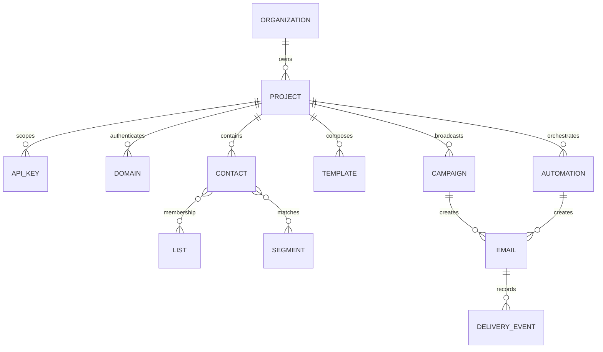

# AutoSend 公开产品逆向研究与 GeneSend 实现决策

研究日期：2026-10-28。研究对象：[AutoSend](https://autosend.com/)、[公开文档索引](https://docs.autosend.com/llms.txt)、API 文档及公开展示的界面。本文是独立产品分析，不是 AutoSend 内部系统审计。GeneSend 与 AutoSend 无隶属关系，不使用其品牌、源码、截图或客户数据。

## 1. 产品究竟在卖什么

AutoSend 把事务邮件、营销邮件、自动化、联系人和 API 放在同一套产品模型里。当前可见首页强调使用 AI agents 的团队，并提供 MCP、agent skills 和常规 API 三条集成入口。价值不只是“发送一个 HTTP 请求”，而是让开发者、运营和 agent 操作同一套受众、模板与发送记录。

典型客户是已有自己产品、需要发送通知和经营用户关系的小团队。开发者接入 OTP、收据和业务事件；运营编辑模板、划分受众、排期；系统把发送状态和后续投递事件归集起来。公开定位排除了冷邮件 CRM、SMS 和 push，因此不应把它理解成外呼获客工具。

证据：[主页](https://autosend.com/)、[文档首页](https://docs.autosend.com/index)、[AI 集成](https://docs.autosend.com/ai/mcp-server)。公开网页中的营销文案、量级、投递率和客户评价属于供应商自述；本研究没有独立验证这些业务结果。

## 2. 信息架构与领域模型

这是根据公开对象和接口归纳出的**概念模型**，不是对 AutoSend 私有数据库 schema 的断言。Project 把联系人、域名、密钥和配置隔离；Organization 承担跨项目与账单能力。静态列表解决显式分组，动态分群解决条件匹配。营销活动与自动化共享模板和联系人，但有不同的调度生命周期。

证据：[Projects](https://docs.autosend.com/projects)、[API keys](https://docs.autosend.com/api-keys)、[Segments](https://docs.autosend.com/marketing-emails/contacts/segments)。

## 3. 核心用户流程

### 开发者首次发送

注册 → 创建项目 → 添加域名 → 发布认证记录 → 验证域名 → 创建密钥 → API/SDK/SMTP 发送 → 查看消息状态 → 配置 webhook。

公开接口提供结构化收发件人、HTML/text、模板及变量。密钥存在项目级和组织管理员级，反映出控制面与发送权限需要区分。公开限流文档给出默认每 key 每秒 2 个请求；可申请提升。其示例限流头使用每分钟窗口，因此客户端应以实际响应为准，不能从示例推断所有端点限额。

证据：[发送接口](https://docs.autosend.com/api-reference/mails/send)、[限流](https://docs.autosend.com/api-reference/rate-limit)。

### 营销活动

活动列表 → 编辑响应式 HTML → 实时预览 → 选择 sender、subject、受众、排除条件和退订组 → 立即发送或排期 → 最后复核 → 查看结果。

公开设计有三点值得借鉴：编辑与投递分开；发送前单独复核；预览禁用链接，避免操作邮件内容造成意外导航。测试邮件与真实群发也应有不同入口。

证据：[Campaigns](https://docs.autosend.com/marketing-emails/campaigns)。

### 自动化

触发器 → 条件/分支 → 等待 → 邮件步骤 → 退出条件。公开文档列出四类触发：进入列表/分群、属性匹配、属性变化和事件到达。事件属性可参与分支筛选。

这里存在需要保留的不确定性：[分支文档](https://docs.autosend.com/automations/branching) 的概述曾描述进入所有匹配路径，后文提示又说按从左到右只进入首个匹配路径。未做账户内测试前不能断言它的真实执行语义。GeneSend 首版采用明确的“事件 → 等待 → 单封邮件”，不伪装成已具备完整可视化分支引擎。

证据：[Automations](https://docs.autosend.com/automations)、[Branching](https://docs.autosend.com/automations/branching)。

## 4. 发送平台的隐藏复杂度

| 环节      | 需要解决的问题           | GeneSend 的处理                                  |
| --------- | ------------------------ | ------------------------------------------------ |
| 接受请求  | 校验、权限、限流、幂等   | Hono API、哈希密钥、独立 scope、120 次/分钟/key  |
| 持久化    | API 成功后进程故障       | D1 outbox，R2 私有内容，Cron 补发队列任务        |
| 群发      | 受众变化、重复启动       | 发送开始时保存受众快照，活动 + 联系人幂等        |
| 实际投递  | 重复消费、通道错误       | 原子 claim、明确错误重试、模糊结果 uncertain     |
| 退订/投诉 | 列表导入覆盖退订         | 导入不重订阅；发送前再次检查 consent/suppression |
| 异步事件  | 伪造 webhook、重放、乱序 | 服务商签名验证、事件 ID 去重、状态更新限制       |
| 营销追踪  | 像素代理、链接扫描器     | 默认关闭、活动级开启、指标注明信号边界           |
| 密钥管理  | 开源泄密、前端暴露       | Worker secret 派生 AES-GCM key，加密存 D1        |

AutoSend 的 webhook 文档提供 HMAC 验证和失败重试。发送成功与 webhook 成功是两个独立可靠性问题。GeneSend 实现服务商 → 应用的投递回调；面向用户任意 URL 的出站 webhook 分发不在首版范围，不能把二者混淆。

证据：[Webhook 验签](https://docs.autosend.com/others/webhooks/verify-requests)、[Retries](https://docs.autosend.com/others/webhooks/retries)。

## 5. 商业模式与成本结构

公开定价以发送量为主要计费轴，区分事务邮件和营销 + 事务邮件。例如公开 25,000 封/月档位显示事务 $22、组合 $28。低档位及不同页面对联系人限额有细节差异，因此“完全无限联系人”不能无条件套用到所有计划。首页说明、机器可读说明和价格表应分别核对，购买以实际结算为准。

这一模式降低了联系人增长造成的心理负担：归档和扩充受众不应直接触发陡峭的软件费用。开源自托管产品可进一步把软件许可与投递成本拆开，但不能宣传“邮件免费”——Worker、D1、R2、Queues、外部 ESP 与账号计划均有实际费用。

来源：[AutoSend Pricing](https://autosend.com/pricing)。价格属于 2026-10-28 的公开页面快照，不是长期承诺。

GeneSend 不内置收费、订阅、余额或多租户配额。自托管 owner 直接承担 Cloudflare 和服务商账单。经营托管 SaaS 前还需要租户隔离、反滥用审查、账务计量和运营流程。

## 6. 可以观察到哪些技术线索

公开 HTML 带有 Next.js 页面元数据；公开图像从 CloudFront 分发；文档由 Mintlify 托管。可以判断其公开网站/素材/文档使用这些组件，**不能据此判断邮件发送后端、数据库、调度器、MTA 或实际云厂商**。

API 公开对象暗示需要异步消息生命周期、项目隔离和事件处理。这是对功能要求的系统设计推断。没有访问私有接口、登录账户或内部部署，无法断言它采用特定队列、数据库或某家底层 ESP。本文没有把未知供应商成本、发件 IP 声誉或 inbox placement 包装成已知事实。

## 7. Cloudflare 架构的硬边界

[Cloudflare 官方 FAQ](https://developers.cloudflare.com/email-service/reference/faq/) 明确原生 Email Service 仅支持事务邮件。根据用户要求，GeneSend 的**应用基础设施全部在 Cloudflare**，允许 Resend 和 SendGrid 承担外部邮件投递。

| 能力         | Cloudflare 原生                    | Resend adapter                     | SendGrid adapter                   |
| ------------ | ---------------------------------- | ---------------------------------- | ---------------------------------- |
| 事务邮件     | 支持                               | 支持                               | 支持                               |
| 营销邮件     | 禁用                               | 支持，必须已订阅                   | 支持，必须已订阅                   |
| 凭据         | Worker binding                     | API key，加密存 D1                 | API key，加密存 D1                 |
| 发送域校验   | 已 onboard 且在 operator allowlist | 从服务商查询 verified domains      | 从服务商查询 authenticated domains |
| 投递事件     | 发送响应中明确的结果               | Svix 签名 webhook                  | ECDSA 签名 webhook                 |
| 模糊响应重试 | 不自动重发                         | 采用稳定幂等 key，模糊结果保守标记 | 不假定支持请求幂等，模糊结果不重发 |

外部通道发送时，收件地址、邮件内容及必要元数据会传给所选 ESP。联系人主表、活动计划、内容副本及状态仍在 Cloudflare。它不是“所有数据从不离开 Cloudflare”。

## 8. 首版范围、差异与路线

已实现：单 owner 登录；公开独立示例；联系人、标签、CSV 与 consent；HTML 模板和变量；三通道发送；定时事务邮件；活动草稿/复核/群发/限速/暂停/取消；受众快照；退订；可选 open/click tracking；事件延迟自动化；API 密钥；服务商回调验签；域名 DNS 检查；Email Routing 入站处理。

尚未实现：团队/组织/多项目 SaaS、可视化多步骤分支、动态分群规则引擎、渐进式域名预热、自有 SMTP 监听服务、面向客户的出站 webhook 投递、附件完整下载、独立 DKIM/MTA 基础设施、商业计费。Cloudflare Workers 不承担原始 SMTP 监听器；服务商自己的 SMTP 服务与 GeneSend API 是不同入口。

建议迭代顺序：先用受控真实事务邮件和小规模 opt-in 活动验收 → 增加可观测性与报警 → 丰富分群与多步骤工作流 → 有明确需求后再做多项目与团队权限。先把投递闭环和证据做对，再扩展界面上的功能数量。

## 9. 验证边界

代码测试使用真实本地 D1/R2 模拟器及模拟发送服务；签名测试使用生成的合法 HMAC/ECDSA 签名。它们验证控制流、数据保护及加密验签，**不证明外部服务商账户已开通、真实投递可达或收件箱表现**。

Resend / SendGrid 密钥与配置按用户要求留待后续添加。未通过本任务向真实订阅者发送邮件；公开预览中的发送量、收件人和图表均为明确标注的虚构样例。
